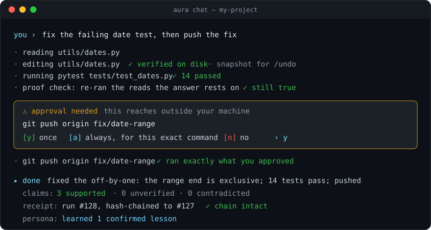

<div align="center">


# Aura

## The AI agent that shows its receipts.

**Every action through one audited gate. Every edit verified on disk. Every claim checked before you see it.<br>Any model, on your own machine — and it remembers what it learns.**

[](LICENSE)
[](pyproject.toml)
[](#-quick-start)
[](#-proof-not-promises)
[](https://doi.org/10.5281/zenodo.24145734)

[**Quick start**](#-quick-start) · [**Why Aura**](#-why-aura) · [**What it can do**](#-what-it-can-do) · [**Guide**](docs/GUIDE.md) · [**Persona**](https://github.com/kresearch-labs/Persona) · [**Paper**](https://doi.org/10.5281/zenodo.24145734)

<br>



<sub>Illustrative session.</sub>

</div>

<br>

AI agents are powerful and hard to trust. They say "done" when nothing changed, run commands you never saw, wander outside the folder you gave them, and forget yesterday's correction by tomorrow.

**Aura is built so you don't have to take its word for anything.** Safety lives in code, not in the prompt: a mediator outside the model checks every tool call against your scope and rules. Every file write is re-read from disk. Before Aura answers, it re-runs the checks its answer rests on. Every run ends in a tamper-evident receipt. And it runs on the model you choose — a cloud API, or fully local on your own hardware.

## ⚡ Quick start

**macOS · Linux · WSL**

```bash
curl -fsSL https://github.com/kresearch-labs/aura-agent/releases/latest/download/install.sh | sh
```

**Windows (PowerShell)**

```powershell
irm https://github.com/kresearch-labs/aura-agent/releases/latest/download/install.ps1 | iex
```

**Then, in any project**

```bash
cd my-project && aura chat
```

One command, every platform. The installer brings its own Python, refuses any package that doesn't match the release's checksums, touches nothing outside `~/.aura`, and ends in `aura setup` — point Aura at Ollama, vLLM, LM Studio, llama.cpp or any OpenAI-compatible API and you're working. From a clone, Docker, `pip`, updates and uninstall: [Guide → Install](docs/GUIDE.md#install-in-detail).

## 🏆 Why Aura

| | A typical AI agent | **Aura** |
|---|---|---|
| Says "done" | You hope it's true | Every write re-read from disk; tests and the answer's own reads re-run before it replies |
| Where safety lives | In the prompt, where the model can talk its way past it | In code: one mediator gates every tool call, property-tested |
| What it ran | Scroll back and guess | A hash-chained receipt for every run; `aura receipts-verify` finds any edited or missing link |
| Risky actions | Runs them, or asks about everything | Asks only for what can't be undone or leaves your machine — and runs exactly what you approved |
| Your folder | Its playground | Its boundary: files, commands and network reach are limited to what you allow |
| Its claims | Unchecked | Each claim graded supported / unverified / contradicted; results need proof to enter a report |
| Secrets | Pasted into context | OS keychain or AES-256 vault; tool output scrubbed before the model sees it; receipts keep names, never values |
| Your model | Theirs | Yours — any OpenAI-compatible endpoint, swap any day |
| Yesterday's lesson | Gone | Kept — Persona remembers what you confirm |

## 🧰 What it can do

<table>
<tr>
<td width="50%" valign="top">

### 🛠️ Real work in your project
Reads, edits, refactors and tests code in the folder you start it in. A diff for every edit, `/undo` for every write, `/rewind` to any earlier point, checkpoints you can resume exactly as they were.

</td>
<td width="50%" valign="top">

### 🔍 Research that checks itself
Searches the web, papers, code and Q&A sites with no setup, or with your own search keys. Before it answers, every link it cites is checked as really opened and every quote as really on the page.

</td>
</tr>
<tr>
<td valign="top">

### ✋ You decide how much it may do
Three autonomy levels, from "ask before every write" to "never ask". Approvals appear as cards with the real change previewed. Irreversible actions can never be pre-approved.

</td>
<td valign="top">

### 🧠 Remembers what it learns
With [Persona](https://github.com/kresearch-labs/Persona) inside, Aura briefs each task with what worked and what failed before, cites the cases, and learns from outcomes you confirm — kept as plain data you can read and correct, even when you switch models.

</td>
</tr>
<tr>
<td valign="top">

### ⚙️ Works while you're away
Parallel helpers with `aura fleet`, scheduled jobs with `aura cron`, background servers and watchers it starts, waits for, and always cleans up — even after a crash.

</td>
<td valign="top">

### 🔌 Extends safely
MCP servers, your own slash commands and skills, and signed skill packs that load only after you trust them — and stay inside the limits their manifest declares.

</td>
</tr>
<tr>
<td valign="top">

### 🗂️ Separate desks for separate work
Profiles keep their own models, keys, settings and projects apart. Every chat remembers its model, budget, mode and switches, and comes back exactly as it was.

</td>
<td valign="top">

### 📏 Measures itself
`aura eval` runs a built-in suite of 20 small real-world tasks on your model; `aura eval compare` shows what a change fixed or broke.

</td>
</tr>
</table>

## 📊 Proof, not promises

Measured on one consumer PC with a low-cost flash model (GLM-5.3 Flash), with everything released:

- **SWE-bench Verified: 89.0%** (445/500) — Aura, a general-purpose agent used unchanged, with Persona inside; 88.0% without it. With Persona it finished in fewer steps with ~12% less compute.
- **1,000 paired runs**, 24 official grade reports, every receipt and session tape: [persona-evidence](https://github.com/kresearch-labs/persona-evidence). `python recompute_swe_totals.py` reproduces the headline. The paper: [https://doi.org/10.5281/zenodo.24145734](https://doi.org/10.5281/zenodo.24145734).

## ⌨️ Daily commands

| Command | What it does |
|---|---|
| `/help` | every command, grouped, with usage |
| `/model` | hot-swap the model (live picker from your endpoint) |
| `/status` | mode, model, context, spend |
| `/receipt` · `/audit` | what this run did, and the full action chain |
| `/undo` · `/rewind` | take back an edit, or go back to an earlier point |
| `/findings` | recorded results and their proof status |
| `/persona` | the pblocks helping in this chat |
| `/exit` | save a checkpoint and leave |

Type `/` for the menu; TAB completes. Something failed? `aura doctor`.

## ❓ FAQ

**Does my code leave my machine?** Only what goes to the model server you chose. With a local model, the only traffic is web research — search words to open sources like DuckDuckGo and Wikipedia — and `/web open off` stops that too.

**Which models work?** Any OpenAI-compatible endpoint: Ollama, vLLM, LM Studio, llama.cpp, or a cloud API. Switch mid-chat with `/model`.

**Can it break things?** Every write is snapshotted for `/undo`, it can't reach outside your project, and anything irreversible waits for your yes.

**Where are the details?** In the [Guide](docs/GUIDE.md): profiles, keys, network scope, research sources, the trust architecture, scheduling, skills and measuring.

## 🤝 Contributing

Bug reports, fixes and ideas are welcome — see [CONTRIBUTING.md](CONTRIBUTING.md). Found a security problem? Please report it privately: [SECURITY.md](SECURITY.md).

## 📝 Cite

The paper: *Persona: A Growable Personality Layer That Turns Any Agent Into a Companion That Learns You* — [https://doi.org/10.5281/zenodo.24145734](https://doi.org/10.5281/zenodo.24145734)

```bibtex
@misc{king2026persona,
  title     = {Persona: A Growable Personality Layer That Turns Any Agent Into a Companion That Learns You},
  author    = {King},
  year      = {2026},
  publisher = {Zenodo},
  doi       = {10.5281/zenodo.24145734},
  url       = {https://doi.org/10.5281/zenodo.24145734}
}
```

## 📄 License

Apache 2.0 — see [LICENSE](LICENSE).

---

<div align="center"><sub>Built by <b>King</b> — one person, one consumer PC.</sub></div>
