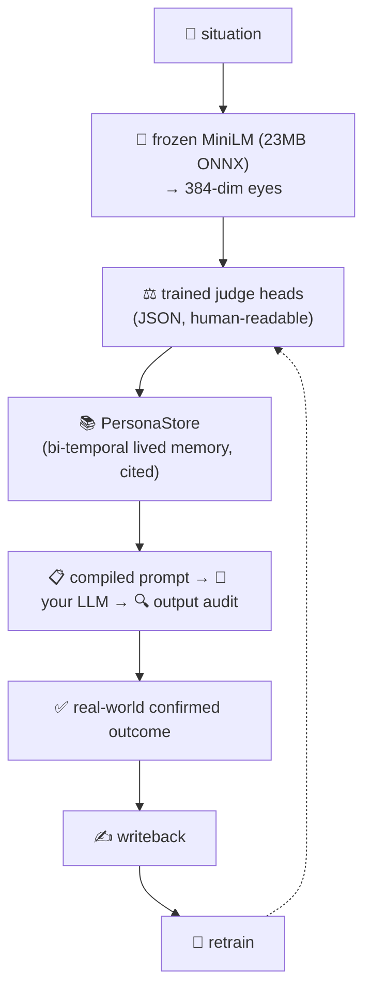

<div align="center">

# ⚙️ The pblock engine

**A self-training judgment layer for AI agents — any domain, not just software.**

[🖼️ The idea](#%EF%B8%8F-the-idea-in-one-picture) · [📜 Design laws](#-design-laws) · [📁 What's here](#-whats-in-this-folder) · [⚡ Quickstart](#-quickstart) · [🎯 Honest scope](#-honest-scope) · [🔧 Configuration](#-configuration)

</div>

<p align="center"><sub>📄 Prefer plain text with every detail? <a href="plain/ENGINE_README.md">Read the plain version</a></sub></p>

<table>
<tr>
<td width="50%" valign="top">

### 😐 Normal agents

pipe input straight into the model and **trust whatever comes back.**

</td>
<td width="50%" valign="top">

### 🧠 With a pblock

a small, inspectable persona sits between the agent and the model: it **embeds** the situation, **judges** it with trained heads, **retrieves** its own lived experience, and **audits** the output before anyone sees it.

</td>
</tr>
</table>

> [!TIP]
> When the real world confirms an outcome, the experience is written back and the persona retrains — **the loop closes, the persona gets better, and every step of that growth is readable data, not a black box.**

---

## 🖼️ The idea in one picture



## 📜 Design laws

| | Law | |
|---|---|---|
| 👁️ | **The eyes never change.** | One frozen 23MB ONNX embedder serves every persona; all learning lives in small JSON heads and stores (measured: fine-tuning the embedder adds no accuracy at product corpus scale while destroying auditability). |
| ✅ | **Only confirmed outcomes write back.** | A resolved market, a passing test, an archive label — the domain decides what "confirmed" means; the writeback law (candidate → corroborated → active, supersede never delete) is universal. |
| 🌱 | **Specialization is earned.** | You ship exactly one blank pblock. It grows because your domain's outcomes demand it — never pre-built from an org chart. |

---

## 📁 What's in this folder

| File | What it does |
|---|---|
| 🗄️ `store.py` | bi-temporal case store: two-stage writeback law, cosine retrieval, snapshots, supersession |
| 🎛️ `orchestrator.py` | panel selection, input review, prompt compilation, prompt diary (the framing→outcome join) |
| ⚖️ `judge_v0.py` | fitted log-loss heads with announced abstention (500-confirmed floor, 50-minority-per-label floor) |
| 👁️ `working_state.py` | frozen MiniLM-L6 int8 ONNX eyes + EMA working state |
| 🔍 `output_audit.py` | return-side claim audit (pass/flag/fix, attributed) |
| 🔗 `verdict_link.py` | receipt→diary outcome join, confidence updates, failure marks + bi-temporal supersession (SCARS) |
| 📐 `schemas.py` | record shapes |
| 🧬 `embeddings.py` | drop-in ONNX embedder binding |
| 🌱 `blank-pblock.yml` | the one seed persona — generic, unfilled, yours |
| 🏋️ `train_pblock.py` | the trainer: template → heads + store, gate-checked |
| 🔁 `pblock_learn.py` | end-of-run self-training organ (wired at loop exits) |
| 📦 `models/minilm-l6-int8/` | the frozen embedder (ships here, 23MB) |
| 📖 `docs/CORPUS_TRAINING_METHODOLOGY.md` | the 3-wave corpus law |
| 🧪 `docs/toy-example/` | end-to-end smoke test (template + corpus maker) |

---

## ⚡ Quickstart

```bash
python -m venv .venv && . .venv/bin/activate
pip install numpy pyyaml onnxruntime
```

**1️⃣ Smoke test** — train a support-ticket persona on the toy corpus:

```bash
python docs/toy-example/make_corpus.py
python train_pblock.py --template docs/toy-example/toy-pblock.yml
```

**2️⃣ Make it yours** — copy the template, point it at YOUR domain:

```bash
cp docs/toy-example/toy-pblock.yml my-domain.yml
#    edit: territory, labels (keyword rules), corpus path, gates
#    corpus = records of {situation, outcome} with REAL confirmed outcomes
#    (see docs/CORPUS_TRAINING_METHODOLOGY.md for how to build it)
python train_pblock.py --template my-domain.yml
```

**3️⃣ Wire the persona into your host agent loop** — the orchestrator compiles lived precedents into the prompt, the output is audited, and a real confirmed outcome writes back through `verdict_link` (the loop closes). `pblock_learn.py` fires at every run exit of the host engine. See [INTEGRATION.md](https://github.com/kresearch-labs/Persona/blob/main/INTEGRATION.md).

> [!NOTE]
> The trainer prints a **PASS/FAIL gate report** (corpus size, label variety, retrieval latency — measurements) and writes the head artifact + store. The persona's judgment is now loadable by any host engine; **every weight in the artifact is human-readable.**

---

## 🎯 Honest scope

| ✅ This folder is the core | 📝 Documented, not yet code here | 🏠 Lives in the host agent loop |
|---|---|---|
| the organ stack, the store, the trainer, the learner, and one blank seed persona | embedder contrastive fine-tuning, LoRA backbone passes, and isotonic calibration refits — the playbook specifies them; the core loop above does not depend on them | the self-repair edge and the sycophancy monitor |

---

## 🔧 Configuration

`pblock_learn.py` reads two env overrides:

```bash
export AURA_PBSTORES=/absolute/path/to/stores   # where stores live
export AURA_ENGINE_PATH=/absolute/path/to/engine
export AURA_PBLEARN=0   # disable end-of-run self-training
```
