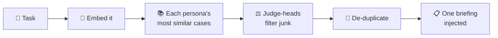
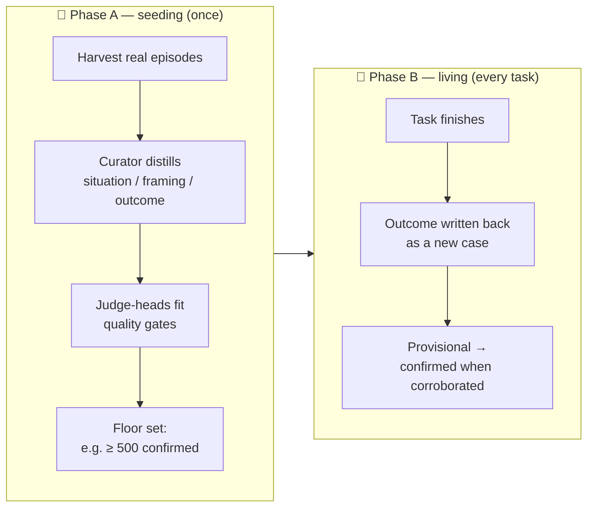
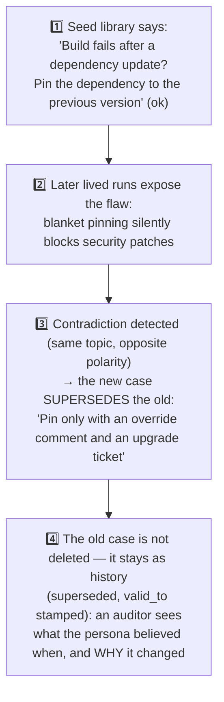
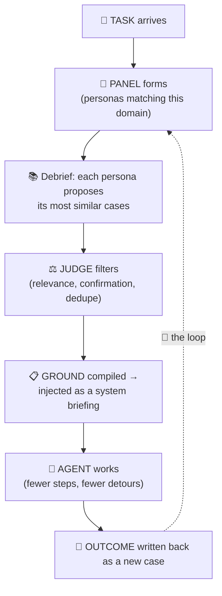

<div align="center">

# 📘 Persona & PBlocks — The Complete Guide

**What it is · how it works · what it costs · why you'd want it**

[⏱️ 60 seconds](#-part-0--the-60-second-version) · [🧩 The problem](#-part-1--the-problem-it-solves) · [📄 A pblock](#-part-2--what-a-pblock-looks-like) · [💬 The prompt](#-part-3--the-prompt-without-vs-with-pblocks) · [🌱 Training](#-part-4--training-when-how-long-how-much) · [✏️ Revision](#%EF%B8%8F-part-4b--revision-fixing-wrong-lessons) · [⚡ Speed](#-part-5--does-it-slow-the-pc-down) · [💰 Cost](#-part-6--is-it-cost-effective-in-the-long-run) · [🎯 Why](#-part-7--why-you-should-want-pblocks) · [❓ FAQ](#-part-8--faq) · [🧠 Mental model](#-part-9--one-page-mental-model)

</div>

<p align="center"><sub>📄 The original text — for readers who want every detail, and the version agents follow: <a href="../HOW-PBLOCKS-WORK.md">read it here</a></sub></p>

> [!NOTE]
> Written in two layers: **SIMPLE** (the plain-language boxes) and **TECHNICAL** (precise). All performance numbers come from real measured campaigns — never assumed — and are illustrative of the mechanism at production scale.

---

## ⏱️ PART 0 — The 60-second version

<table>
<tr>
<td width="50%" valign="top">

### 😵 A normal AI agent

A smart person with **amnesia**: every job is their first day, forever.

</td>
<td width="50%" valign="top">

### 📓 Persona + pblocks

The same person carrying a **notebook of every job they ever did**. Before each new job they flip to the pages that look similar and read: *what worked, what failed, what to avoid.*

</td>
</tr>
</table>

> [!TIP]
> Measured on real software-engineering benchmarks: the notebook-carrying agent **solved more tasks while spending FEWER total tokens** than its amnesiac twin on identical tasks.

**Three words, defined once:**

| | Word | Meaning |
|---|---|---|
| 🎭 | **Persona** | a named specialist role the agent can summon (bug localizer, doctor, qa critic...). The product concept. |
| 📦 | **pblock** | ONE persona's memory: its collection of solved episodes ("cases") plus the machinery that retrieves, cites, and grows them |
| 👥 | **Panel** | SEVERAL pblocks consulted on the same task; their lessons are judged, de-duplicated, and compiled into one briefing |

---

## 🧩 PART 1 — The problem it solves

An agent sees only what is in its prompt. **Without memory:**

| | What goes wrong |
|---|---|
| 🔁 | it re-discovers the same pitfalls on every run — a parsing bug that burned it 20 tasks ago burns it again today |
| 💨 | its successes die with the session; nothing compounds |
| 💸 | you pay full exploration price every single time |

**With pblocks,** every finished run writes back what happened. The next similar task starts from experience instead of zero.

> [!IMPORTANT]
> **The unit of value is the precedent:** *in this situation, this approach produced this outcome.*

---

## 📄 PART 2 — What a pblock looks like

One case inside a persona's memory (real shape, anonymized):

```jsonc
{ "persona":   "bug_localizer",
  "situation": "Import error appears only in the packaged app, not in dev",
  "framing":   "Check packaging exclusions first — dev setup hides the module",
  "outcome":   "ok (fixed by including data file in package manifest)",
  "confirmed": true,            // vetted: trustworthy lesson
  "origin":    "lived",         // learned from a real run, not invented
  "embedding": [384 numbers] }  // fingerprint for finding similar tasks
```

| Field | What it holds |
|---|---|
| 🌍 **situation** | what the world looked like when the task began |
| 💡 **framing** | the distilled lesson: the approach worth remembering |
| 🏁 **outcome** | what actually happened (success, failure, score) |
| ✅ **confirmed** | vetting flag; only confirmed cases are cited as gospel |
| 🧬 **embedding** | a 384-number fingerprint of meaning, so "similar task" is computed mathematically, not guessed |

> A pblock with a thousand of these is **a textbook written by experience.**

---

## 💬 PART 3 — The prompt: without vs with pblocks

<table>
<tr>
<th width="50%">❌ 3.1 A NORMAL prompt (no pblocks)</th>
<th width="50%">✅ 3.2 The SAME prompt with pblocks</th>
</tr>
<tr>
<td valign="top">

```text
System: You are a software-engineering
agent. Solve the issue.
Tools:  [read_file, write_file,
         run_tests...]

User: The test test_combine_nested
fails with KeyError 'copy' when
merging overlapping intervals.
Repository: <code>.
Find the bug, patch it, prove the
test passes.
```

**Agent:** *(starts exploring blindly — opens files, guesses, tries a patch, runs tests, hopes)*

Everything the agent knows about THIS class of task must be re-derived by trial and error, and each failed trial costs tokens and time.

</td>
<td valign="top">

```text
System: You are a software-engineering
agent...

System: ### PANEL GROUND (compiled from
lived cases — work from these; if
something is not here, say so)

[bug_localizer] Overlapping-interval
merges choked on the 'copy' key before
— the patch site is the merge routine,
not the caller (outcome: ok)
[qa_critic] Recursion hides the failure
one level deep — run the failing test
verbosely before patching (outcome: ok)
[past failure] Naive dict-merge patch
(outcome 0.0) — nested structures need
a deep-merge guard; do not re-attempt

User: The test test_combine_nested
fails with ...
```

</td>
</tr>
</table>

The agent never sees the bare prompt. Before its first step, the panel machinery:



> [!TIP]
> **Same task. Same model. Same tools.** One arm walks in with written experience; the other walks in blind.
>
> *Simple version: the with-pblocks prompt is like sitting an exam after studying that examiner's previous papers. The without-pblocks prompt is walking into the exam hall cold.*

---

## 🌱 PART 4 — Training: when, how long, how much

> [!NOTE]
> There are two phases. **Neither is "model training"** — no GPUs, no weights change. "Training" a pblock = **building its case library**.



| | 🌱 **Phase A — seeding** | 🔁 **Phase B — living** |
|---|---|---|
| **When** | once, when the persona is created, before first use | continuously, automatically, after every completed task |
| **How** | harvest real episodes for the persona (from benchmark suites, your own runs, or hand-written ones); a curator distills each into situation/framing/outcome; judge-heads fit their quality gates; a floor is set (e.g. "at least 500 confirmed cases before this persona is trusted") | the finished run's outcome is written back as a new case (marked provisional until corroborated, then confirmed). Every new case is visible to the very next run. |
| **Time** | for one persona with ~1–3k cases, **tens of minutes to a few hours** — dominated by harvesting and distillation, not compute. The retrieval index itself trains in seconds-to-minutes on CPU. | writing one case is milliseconds — invisible in the run |
| **Cost** | near-zero if episodes are harvested from runs already paid for; otherwise a few million tokens across hundreds of episodes | roughly the tokens of a summary paragraph per run — the cheapest learning you will ever buy, because the experience was already paid for |

### 📈 Measured growth (real 1,000-task campaign, fresh-seeded personas)

| Seat | Seeded | Grew during campaign | |
|---|---:|---:|---|
| localizer | 1,440 | +503 | 🟩🟩🟩🟩 **+35%** |
| postmortems | 1,125 | +756 | 🟩🟩🟩🟩🟩🟩🟩 **+67%** |
| triage | 1,080 | +261 | 🟩🟩 **+24%** |
| strategy | 1,440 | +96 | 🟩 **+7%** |
| test-selection | 1,536 | +99 | 🟩 **+7%** |
| **total** | **6,621** | **+1,715** | **+26%** |

> [!NOTE]
> Note the shape: the *reflective* persona (postmortems) grew fastest — that is where experience compounded hardest. Static reference libraries (built once, read-only by design) added 0 rows — they are **textbooks, not diaries.**

---

## ✏️ PART 4b — Revision: fixing wrong lessons

*(and checking every step)* — two more facts, both from the engine itself:

<table>
<tr>
<td width="50%" valign="top">

### 👣 Monitoring is per-step, not just start/end

The briefing is compiled at run start, but the working state is audited after each action, and lessons are captured MID-RUN as milestones resolve (a real captured case reads: *"phase: mid-run resolution — write_file: resolved this step (mid-run success — step 2)"*).

**Learning happens during the run AND after it.**

</td>
<td width="50%" valign="top">

### 🔄 Wrong lessons get revised, not piled over

The store carries a contradiction engine (bi-temporal: every case has `valid_from` / `valid_to`):

- 🔗 a new lived case with HIGH similarity but OPPOSITE outcome polarity to an existing one → both are cross-linked (`contradicts`)
- ⏭️ the new case SUPERSEDES the old: the old keeps its history but is stamped `status: superseded`, `valid_to: now`, `superseded_by: <new>`
- 🪢 one lived case contradicting two seed cases at once (the "tangle" rule) → both seeds are preserved as valid history and mutually wired
- 📈 every time later runs re-prove a lesson, its `confidence` rises and its `corroboration_count` increments — **agreement with reality strengthens a case; disagreement retires it**

</td>
</tr>
</table>

### 🧪 Worked example — revision, not just accumulation



> [!TIP]
> *Simple version: the persona keeps the old wrong page in its notebook, but crosses it out, links it to the corrected page, and from then on re-reads only the corrected one.*

---

## ⚡ PART 5 — Does it slow the PC down?

> [!IMPORTANT]
> **No — the memory machinery is deliberately tiny.**

| | Measured figure |
|---|---|
| 🧬 **Embedding model** | 23MB quantized model on CPU, ~10–20 milliseconds per query, two threads. Runs on Raspberry-Pi-class hardware. |
| 🔎 **Retrieval** | cosine similarity over a few thousand cases — well under a tenth of a second |
| 📋 **Injection** | the briefing adds a one-time chunk to the prompt (+242 to +1,200 tokens on the first call depending on task breadth; ~+8% per turn on average, median ~+6%) |

**Then the bill comes back NEGATIVE:** briefed agents wander less, take fewer steps, and **whole-run token usage dropped ~12% versus the memory-less twin** despite larger prompts. The briefing pays for itself. Wall-clock time equal or better for the same reason.

> 🖥️ Nothing here is heavy: **no GPU, no database server, no infrastructure** — by design ("local-first, zero extra infrastructure" is the engine's own marketing line, and the measurement backs it).

---

## 💰 PART 6 — Is it cost-effective in the long run?

| | | |
|---|---|---|
| 1️⃣ | **Up-front** | seed build = hours + a few million tokens (often effectively free — harvested from runs already paid for) |
| 2️⃣ | **Per run** | briefing adds ~6–8% tokens per turn, cuts steps. Net measured over thousands of paired runs: **−12% total prompt tokens** for the memory-carrying agent |
| 3️⃣ | **Compounding** | every finished run deposits a case; deposits make all future similar runs cheaper and better. Cost curve points down, quality curve points up, simultaneously |
| 4️⃣ | **Failure dividend** | a failed run written back as a 0.0-outcome case is worth MORE than a success — it permanently immunizes every future run against one mistake class |

> [!IMPORTANT]
> One sentence: **memory is the only investment in the stack that appreciates.** Compute depreciates; licenses recur; a good case library compounds.

---

## 🎯 PART 7 — Why you should want pblocks

| | | |
|---|---|---|
| 🏆 | **Same model, better outcomes** | In a 1,000-run software benchmark, the panel arm solved more tasks than its memory-less twin — same model, temperature, tools. The only variable was memory. |
| 💎 | **Failures become assets** | Every stumble converts to permanent institutional knowledge. Nothing is wasted. |
| 🎭 | **Specialists on demand** | Need a music critic? A contract reviewer? Seed a persona — the machinery is identical. Personas are a product surface: create, share, improve. |
| 🔍 | **Transparency by construction** | Every briefing line cites a real recorded case with a real outcome. The instructions tell the agent "if something is not here, say so" — anti-hallucination at the prompt layer. |
| ⚖️ | **Honest ablation** | One flag turns the memory off. The memory-less twin is the same agent; any measured delta IS the pblocks. |
| 📦 | **Cheap to run, impossible to lose** | MB-scale files, CPU retrieval, zero infrastructure. Copy one folder and the agent's entire education travels with it. |

---

## ❓ PART 8 — FAQ

*Rapid fire, simple language — click a question.*

<details>
<summary><b>Is this fine-tuning?</b></summary>

No. The model is never altered. All learning lives in the case library. **Reference binder, not brain surgery.**
</details>

<details>
<summary><b>Where does the knowledge live?</b></summary>

In the persona's case set — portable, human-readable; backing it up is copying one folder.
</details>

<details>
<summary><b>What if a case is wrong or corrupted?</b></summary>

Wrong: unvetted cases aren't cited as authority. Corrupted: quarantined on load, never fatal. The memory survives crashes that interrupt runs.
</details>

<details>
<summary><b>Doesn't stuffing lessons into the prompt confuse the model?</b></summary>

Lessons are judge-filtered and de-duplicated first. In measured campaigns briefed runs took FEWER steps — more signal, less wandering.
</details>

<details>
<summary><b>Do all personas jump in on every task?</b></summary>

Your choice: all eligible, or an allow-list. Two dose profiles (orchestrated vs flat) — profile choice itself measurably moves scores.
</details>

<details>
<summary><b>What does it cost to try?</b></summary>

Almost nothing beyond runs you were doing anyway: seed once (hours), learn forever (automatic). Measured net effect on token spend was negative.
</details>

<details>
<summary><b>When would I NOT want pblocks?</b></summary>

One-off tasks with no repetition; strict low-latency chat; or when you want to benchmark the raw model naively.
</details>

<details>
<summary><b>Failure mode?</b></summary>

A badly curated library (noisy, contradictory, off-topic cases) gives mediocre briefings. Curator + judge gates are the fix. Garbage in, mildly diluted advice out — never a crash, never invented facts.
</details>

---

## 🧠 PART 9 — One-page mental model



<div align="center">

**The agent that yesterday solved a cousin of your problem is, today, briefed on exactly that.<br>Tomorrow it will be better still. That is the whole idea.**

</div>
