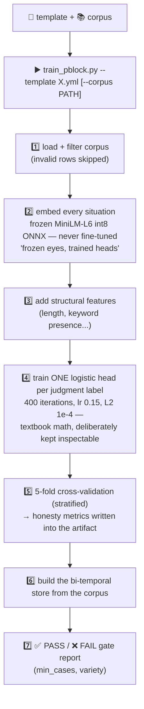
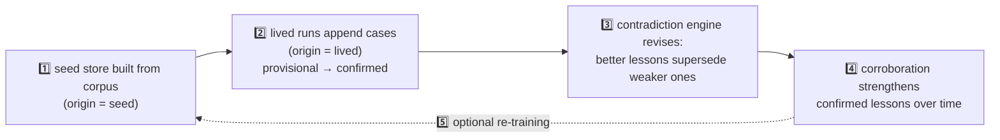

<div align="center">

# 🌱 Training a New PBlock

**Hardware · Research · the Decision Engine**

[⚡ One-line answer](#-part-t1--the-one-line-answer) · [⚙️ What training is](#%EF%B8%8F-part-t2--what-training-actually-is) · [🖥️ Hardware](#%EF%B8%8F-part-t3--hardware-requirements) · [🔬 Research](#-part-t4--the-research-how-the-corpus-gets-decided) · [🚦 Gates](#-part-t5--quality-gates-how-the-engine-says-not-good-enough) · [🔁 Lifecycle](#-part-t6--lifecycle-after-training)

</div>

<p align="center"><sub>📄 The original text — for readers who want every detail, and the version agents follow: <a href="../TRAINING-PBLOCKS.md">read it here</a></sub></p>

> [!NOTE]
> Companion to [HOW-PBLOCKS-WORK.md](HOW-PBLOCKS-WORK.md). Answers: what does it take to create a NEW pblock from scratch? What hardware? What research? Who decides what the persona should know? All facts from the engine source (`train_pblock.py`, `corpus_builder.py`, `embeddings.py`, `store.py`).

---

## ⚡ PART T1 — The one-line answer

> [!IMPORTANT]
> Training a new pblock needs **a laptop**. No GPU, no cluster, no special hardware: the "model" is a 23MB frozen embedder plus a logistic regression you could train on a phone. The real cost is **the research to write the persona's knowledge base** — hours of human (or agent) thinking, minutes of compute.

| | |
|---|---|
| 🖥️ **Hardware for training** | any modern CPU (2 threads is plenty) |
| ⏱️ **Time to train** | seconds-to-minutes of compute |
| 🧠 **Time to prepare** | the real work (corpus research + curation) |
| 🚫 **What is NOT needed** | GPUs, fine-tuning, ML ops, cloud |

---

## ⚙️ PART T2 — What "training" actually is

Training a pblock = **building its case library and judgment head.**

<table>
<tr>
<td width="50%" valign="top">

### 📜 template (`.yml`)
the persona's **constitution**: territory, judgment labels, quality gates

</td>
<td width="50%" valign="top">

### 📚 corpus (`.jsonl`)
its **knowledge**: `{situation, outcome[, framing]}` records — hundreds to thousands of rows

</td>
</tr>
</table>



> [!TIP]
> **Why logistic regression and not a neural net?** By design: every weight is inspectable, training is instant, and the measured finding was that fine-tuning the embedder adds no accuracy at product corpus scale while destroying inspectability. **The intelligence lives in the corpus, not the classifier.**

---

## 🖥️ PART T3 — Hardware requirements

*Measured, not theoretical.*

| Component | Need |
|---|---|
| 🧮 **CPU** | any x86/ARM, 2 threads sufficient (the embedder sets `intra_op_num_threads=2`, commented "Pi-class friendly") |
| 💾 **RAM** | < 1 GB for typical persona training |
| 🗄️ **Storage** | 23MB embedder + MB-scale store output |
| 🎮 **GPU** | none (0 CUDA calls in the codebase) |
| 🌐 **Internet** | only to fetch the corpus/harvest sources |

> 🔁 **The same machine that RUNS the agent can TRAIN the personas.** There is no separate training cluster, no cloud compute bill, no special drivers.

---

## 🔬 PART T4 — The research: how the corpus gets decided

This is the deepest design point, and it is codified as a **LAW** in the source (`corpus_builder.py`):

> [!IMPORTANT]
> ## *"Never pick the number first and fill toward it."*

Meaning: you never say "we need 1,200 cases, write them." Instead, the persona's **TEMPLATE declares its own decision space**, and the corpus builder **CROSS-PRODUCTS** it:

| Ingredient | What it is |
|---|---|
| 📏 **craft_truths** | the seat's real practice rules (written from domain research — the human/agent thinking part) |
| 🧭 **dimensions** | the axes the judgment varies across (e.g. for a doctor: urgency × age-band × symptom-cluster) |
| 🚫 **negations** | the documented failure forms (what BAD practice looks like — teaches avoidance) |
| ↔️ **vocabulary** | contrast pairs (present vs absent phrases) that teach the judge-heads the label boundary |
| 📰 **real_records** | published facts from wave-1 sources |

```text
rows = (decision cells × truths) + interactions + edges
       + vocabulary contrasts + real records
```

> [!TIP]
> **The COUNT FALLS OUT of the declared space** — a narrow territory lands small, a broad one lands large. This prevents padded, repetitive corpora (the failure mode where a library "hits its number" with near-duplicate rows).

### 🧠 Where the research actually goes

Writing **craft_truths** and **dimensions** IS the intellectual work:

- 📖 study the domain's real practice (papers, postmortems, style guides)
- ✍️ distill the rules practitioners actually follow
- 🧭 define the axes along which judgment genuinely varies
- 🚫 collect the documented failure modes (negations)
- ✅ gather verified real cases with known outcomes

This is **hours-to-days of domain thinking per persona** — typically done with an agent assisting the harvest — and it is where all the quality lives.

> [!WARNING]
> **The trainer cannot rescue a shallow corpus:** the gate report will FAIL it (too few cases, insufficient variety) and the persona is not blessed.

---

## 🚦 PART T5 — Quality gates: how the engine says "not good enough"

Training ends in a **PASS/FAIL report**; a persona that fails is not deployed:

| Gate | What it checks |
|---|---|
| 🔢 **min_cases floor** | declared per-persona in the template (e.g. the doctor persona demanded 500+ confirmed cases). Too few → GATE REJECT with the shortfall printed |
| 🌈 **Variety gate** | the corpus must vary across the declared dimensions (a library of near-copies fails even if huge) |
| 📊 **CV honesty fields** | 5-fold stratified cross-validation accuracy is measured at train time and stored IN the artifact; consumers can see how reliable the judge-head is, per label |
| 🤐 **Judge abstention** | at runtime, a judge-head below its gate abstains honestly rather than pretending confidence |

---

## 🔁 PART T6 — Lifecycle after training

> **Training is the START, not the end.**



| Step | |
|---|---|
| 1️⃣ | seed store built from corpus (`origin=seed` rows) |
| 2️⃣ | lived runs append cases (`origin=lived`) — provisional until corroborated, then confirmed |
| 3️⃣ | contradiction engine revises: better lessons supersede weaker ones (bi-temporal history preserved, nothing silently rewritten) |
| 4️⃣ | corroboration strengthens confirmed lessons over time |
| 5️⃣ | re-training (rerunning the trainer with a richer corpus) is idempotent and cheap — but typically unnecessary, because lived write-back already grows the store continuously |

<table>
<tr>
<td align="center" width="33%">📜<br/><b>The .yml template</b><br/>stays the persona's constitution throughout</td>
<td align="center" width="33%">📚<br/><b>The store</b><br/>is the evolving library</td>
<td align="center" width="33%">⚖️<br/><b>The heads artifact</b><br/>is the calibrated judgment</td>
</tr>
</table>

<div align="center">

**Three small files, no infrastructure.**

</div>

---

<sub>📎 *Sources: `train_pblock.py` (trainer flow, logistic math, gates), `corpus_builder.py` (enumeration law, decision-space crossing), `embeddings.py` (frozen MiniLM, 2-thread CPU), `store.py` (bi-temporal lifecycle). Every quoted phrase is from the source comments.*</sub>
